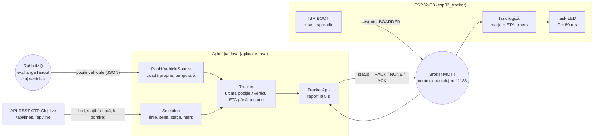
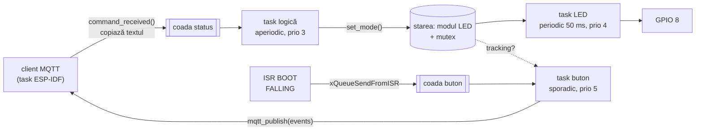

# Tema 04 – Tracker personal de autobuz pe ESP32-C3

Utilizatorul alege în aplicația Java **linia**, **sensul**, **stația** lui și **câte minute merge pe jos** până la ea. Aplicația urmărește în timp real cel mai apropiat autobuz care încă nu a trecut de stație și trimite plăcii ETA-ul. Placa arată pe LED **când trebuie să plece** spre stație. Când urcă în autobuz, utilizatorul apasă **BOOT**, iar aplicația confirmă.

## Arhitectura



**Împărțirea calculului:**
- **Aplicația Java** face ce are nevoie de date: alegerea liniei și a stației din API, pozițiile din RabbitMQ și ETA-ul.
- **Placa** face ce ține de utilizator: din ETA și timpul de mers calculează marja `ETA − mers`, adică cât timp mai are până trebuie să plece, și alege modul LED-ului.

Pragurile LED-ului sunt deci pe placă (`config.h`), nu în Java.

### Calculul ETA (`Tracker`, `RouteGeometry`)

1. Din fluxul RabbitMQ se păstrează doar vehiculele cu `route_id` și `trip_id` ale sensului ales, fiecare cu ultima poziție (`Map` cu cheia `id`).
2. Traseul sensului este aproximat prin segmente drepte între stații consecutive. Fiecare punct are o distanță de la capătul liniei (`along`).
3. Vehiculul se proiectează pe cel mai apropiat segment. Distanța rămasă este `along(stația mea) − along(vehicul)`. Dacă e negativă, autobuzul a trecut de stație și este ignorat.
4. `ETA = distanța / 5 m/s − vechimea poziției`. 5 m/s (~18 km/h) este viteza medie urbană cu opriri. Se scade vechimea poziției pentru că, între timp, autobuzul a mai înaintat.
5. Se alege autobuzul cel mai apropiat de stație.

**Imperfecțiunile datelor reale și cum sunt tratate:**

| Problemă | Tratare |
|---|---|
| câmpuri lipsă (`trip_id`, `timestamp`, `route_id`) | `Vehicle.fromJson` citește cu valori implicite; fără `trip_id` vehiculul e ignorat (sensul e necunoscut) |
| vehicule retrase, care nu mai trimit nimic | poziții mai vechi de 180 s sunt șterse |
| GPS greșit, vehicul în depou | vehicule mai departe de 300 m de traseu sunt ignorate |
| poziții vechi de zeci de secunde | ETA-ul scade vechimea poziției |
| numărul liniei nu e unic (două linii `12`) | alegerea se face după `route_id`; la duplicate utilizatorul alege din listă |

## Mesajele MQTT

Topic-urile sunt sub `ssatr/cristea-liviu/tracker/`. Mesajele sunt text cu câmpuri separate prin `;`, QoS 1, fără retain.

| Topic | Direcție | Mesaj | Semnificație |
|---|---|---|---|
| `.../tracker/status` | Java → placă, la 5 s | `TRACK;<stații>;<eta_s>;<mers_s>` | un autobuz vine spre stație |
| | | `NONE;<mers_s>` | niciun autobuz spre stație |
| | Java → placă, o dată | `ACK` | `BOARDED` primit, urmărirea s-a încheiat |
| `.../tracker/events` | placă → Java | `BOARDED;<deviceId>;<epoch_ms>` | utilizatorul a apăsat BOOT: a urcat |

Exemplu: `TRACK;3;400;240` înseamnă că autobuzul e la 3 stații și ajunge în 400 s, iar utilizatorul are 240 s de mers. Marja e de 160 s.

```mermaid
sequenceDiagram
    participant R as RabbitMQ
    participant J as Aplicația Java
    participant B as Broker MQTT
    participant E as ESP32-C3
    loop la fiecare poziție nouă
        R->>J: {"id":..,"route_id":..,"trip_id":..,"lat":..,"lon":..}
    end
    loop la fiecare 5 s
        J->>B: status: TRACK;3;400;240
        B->>E: TRACK;3;400;240
        Note over E: marja 160 s → LED MEDIUM
    end
    Note over E: utilizatorul apasă BOOT
    E->>B: events: BOARDED;esp32-1cc978;1794...
    B->>J: BOARDED;...
    J->>B: status: ACK
    B->>E: ACK
    Note over E: 3 clipiri, apoi stins
```

## LED-ul și butonul

LED-ul albastru al plăcii (GPIO 8) arată **marja = ETA − timpul de mers**: cât timp mai ai până trebuie să pleci de acasă.

| Mod | Tipar | Când |
|---|---|---|
| `IDLE` | stins | nu urmărește nimic sau niciun autobuz spre stație (`NONE`) |
| `SLOW` | un puls scurt la 2 s | marja > 5 min: **ai timp** |
| `MEDIUM` | clipire 1 Hz | marja între 2 și 5 min: **pregătește-te** |
| `FAST` | clipire 4 Hz | marja < 2 min: **pleacă acum** |
| `AT_STOP` | aprins continuu | autobuzul e în stația ta (0 stații) |
| `STALE` | două pulsuri la 3 s | niciun status de 60 s cât urmărește: aplicația Java oprită sau rețea căzută |
| `ACK` | 3 clipiri, apoi stins | urcarea confirmată de aplicație |

Butonul **BOOT** (GPIO 9) înseamnă **„am urcat în autobuz”**:
- Cât timp placa urmărește, o apăsare publică `BOARDED`. Aplicația răspunde cu `ACK` și se oprește.
- O apăsare când placa nu urmărește nimic este ignorată.
- Apăsările la mai puțin de 1 s de cea acceptată sunt respinse: filtrează bounce-ul și apăsările duble.

## Taskurile de pe placă



| Task | Tip | Activare | Prioritate | Ce face |
|---|---|---|---|---|
| `button_task` | sporadic | apăsare în coadă, interval minim 1 s | 5 | publică `BOARDED` |
| `led_task` | periodic | `xTaskDelayUntil`, T = 50 ms | 4 | tiparul de clipire al modului curent |
| `logic_task` | aperiodic | mesaj în coada status, cu timeout 1 s | 3 | parsează statusul, calculează marja, setează modul; la timeout verifică dacă datele au devenit vechi |
| `button_isr` | rutină de întrerupere | front descendent pe GPIO 9 | – | doar pune momentul apăsării în coadă |

**De ce această împărțire:**
- **LED-ul are nevoie de timp regulat** pentru clipire (4 Hz = perioadă de 250 ms), iar statusul vine doar la 5 s. Așa că decizia (logica) e separată de generarea tiparului (taskul LED periodic). Perioada de 50 ms e rezoluția necesară pentru cel mai scurt puls, cel de 100 ms. `xTaskDelayUntil` păstrează o grilă fixă, fără derivă.
- **Taskul de logică e aperiodic**, condus de mesaje. Timeout-ul de 1 s din `xQueueReceive` îl trezește și fără mesaje, ca să observe **lipsa** lor (modul `STALE`).
- **Butonul trece prin ISR → coadă → task sporadic**. ISR-ul nu blochează și nu publică: doar notează momentul. Taskul impune intervalul minim între sosiri (1 s), care face din el un task sporadic, cu încărcare mărginită.
- **Priorități Rate Monotonic** pentru taskurile periodice. Taskul sporadic are prioritatea cea mai mare, pentru reacția imediată la utilizator. Stă blocat aproape tot timpul și are interval minim între sosiri, deci nu poate înfometa celelalte taskuri.
- **Starea partajată** (modul LED-ului și `tracking`) e protejată de un mutex, ținut doar cât se copiază câteva câmpuri.
- **`command_received()` rulează pe taskul clientului MQTT**, deci doar copiază textul în coadă și nu îl prelucrează acolo, ca la tema 03.

## Cum se rulează

### Secretele (nu sunt în git)
- `aplicatie-java/secrets.properties`: copiat din `secrets.properties.example`, cu `API_KEY`, `RABBIT_USER` și `RABBIT_PASS` primite la laborator.
- `esp32_tracker/secrets.h`: copiat din `secrets.h.example`, cu rețeaua Wi-Fi (2.4 GHz).

Ambele sunt în `.gitignore`.

### Placa
1. Deschideți `esp32_tracker/esp32_tracker.ino` în Arduino IDE.
2. Alegeți placa **ESP32C3 Dev Module**, cu **USB CDC On Boot: Enabled**, și faceți Upload.
3. În Serial Monitor (115200) trebuie să apară `abonat la ssatr/cristea-liviu/tracker/status`.

### Aplicația Java (Java 17+)
Din `aplicatie-java/`:
```
mvn -q compile exec:java                 # date reale (API + RabbitMQ)
mvn -q compile exec:java -Dsim=true      # simulare: linie și autobuz fictive
```
Sau din IntelliJ: `TrackerApp`, cu **Working directory** = `aplicatie-java` și, pentru simulare, cu VM options `-Dsim=true`.

În consolă se alege:
1. numărul liniei (de exemplu `24B`);
2. sensul;
3. stația;
4. minutele de mers până la stație.

Apoi aplicația raportează la fiecare 5 s.

### Modul simulare
Cu `-Dsim=true`, aplicația nu folosește nici API-ul, nici RabbitMQ:
- `SimCatalog` oferă o linie fictivă `SIM`, cu 10 stații la ~500 m una de alta;
- `SimVehicleSource` mișcă un autobuz pe ea cu 5 m/s și raportează poziția la 5 s.

Restul lanțului (ETA, MQTT, placa, butonul) este identic cu cel pe date reale. Așa se poate testa sistemul fără cheie API și fără cont RabbitMQ.

## Structura

```
solutie/
├── README.md
├── .gitignore                     secrets.properties, secrets.h
├── aplicatie-java/
│   ├── pom.xml                    amqp-client, paho mqttv3, jackson
│   ├── secrets.properties.example
│   └── src/main/java/ssatr/tracker/
│       ├── TrackerApp.java        main: alegere, bucla de raportare, BOARDED -> ACK
│       ├── Config.java            adrese, topic-uri, STUDENT
│       ├── Secrets.java           citește secrets.properties
│       ├── Model.java             Line, Direction, Stop (JSON din API)
│       ├── LineCatalog.java       ApiClient (API REST) / SimCatalog (simulare)
│       ├── Selection.java         dialogul linie -> sens -> stație -> mers
│       ├── Vehicle.java           o poziție, din JSON-ul RabbitMQ
│       ├── VehicleSource.java     RabbitVehicleSource / SimVehicleSource
│       ├── RouteGeometry.java     traseul ca segmente, proiecția pe traseu
│       ├── Tracker.java           ultima poziție / vehicul, estimarea ETA
│       └── MqttConnection.java    clientul MQTT (din temele 01-03)
└── esp32_tracker/
    ├── esp32_tracker.ino          taskurile, ISR-ul, logica LED-ului
    ├── tracker_types.h            Status, LedMode, TrackerState
    ├── config.h                   broker, STUDENT, pini, perioade, praguri
    ├── connection.h/.cpp          Wi-Fi, SNTP, MQTT (din tema 03, topic "status")
    └── secrets.h.example
```